
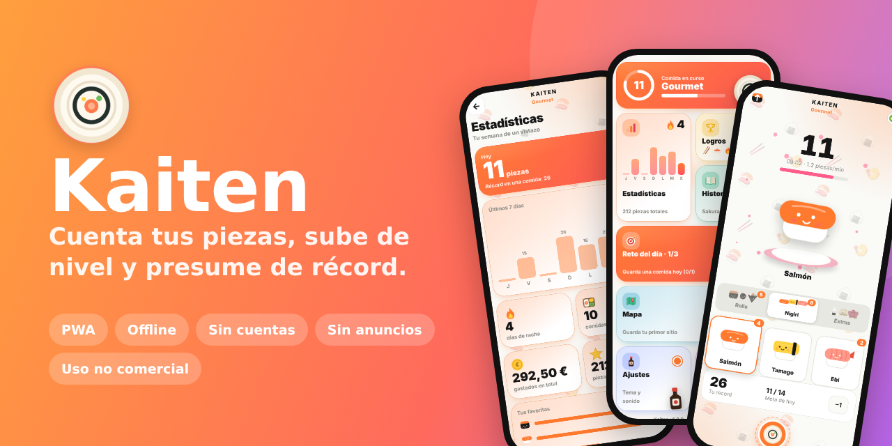

<h1 align="center">🍣 Kaiten</h1>

<b>Cuenta tus piezas de sushi, sube de nivel y presume de récord.</b> 
Una app de un solo archivo, sin cuentas, sin anuncios y 100 % offline.

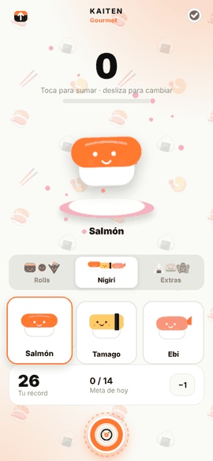

## ✨ Características

| Categoría | Qué incluye |
|---|---|
| 🎮 **Juego** | Contador táctil con combos, ritmo en piezas/min, meta de la comida y récord personal. 9 tipos de pieza en 3 categorías: Rolls, Nigiri y Extras. |
| 🧭 **Navegación** | Botón-plato central que abre un menú bento con vista previa en vivo de cada sección; también con swipe ↑. Compatible con el botón Atrás del móvil. |
| 📊 **Progreso** | Estadísticas con gráfica de 7 días, racha, favoritas, gasto total y un historial de comidas con lugar, duración y coste. |
| ⭐ **Reseñas** | Al terminar la comida: de 1 a 5 piezas, etiquetas (fresco, buen precio, servicio…), nota personal, hasta 4 fotos y tu ubicación con un toque. Todo se puede editar después desde el Historial, con autocompletado de los sitios que ya has usado. |
| 🗺️ **Mapa** | Mapa de tus sitios con un pin por restaurante y tu nota media, lista ordenada por valoración, y opción de colocar el pin a mano. Usa [OpenFreeMap](https://openfreemap.org) y MapLibre: gratis y sin claves. Botón *Abrir en Google Maps* en cada comida. |
| 🏆 **Logros y retos** | 11 medallas ilustradas, niveles y 3 retos distintos cada día. |
| 🎨 **Personalización** | Temas (incluido Dojo y Noche), color de acento, sonidos y vibración. |
| 📤 **Compartir y datos** | Tarjeta en imagen del contador y de cada comida (con tu foto), copia completa con fotos en un archivo, y aviso si llevas más de 30 días sin copia. La importación se valida y limpia. |
| 💻 **Escritorio** | A partir de 1000 px se muestra un panel en directo junto al contador (comida en curso, estadísticas, logros, retos) y todas las secciones se abren a su lado. Atajos de teclado: `Espacio` +1, `⌫` −1, `1` `2` `3` categoría, `←` `→` pieza, `F` terminar comida, `0` panel. Ideal para usarla mientras comes en el ordenador. |
| 📱 **Adaptable** | Se ajusta a móviles pequeños (desde 320 px), apaisado, tabletas y monitores grandes, sin desbordes. |
| 📲 **PWA y privacidad** | Instalable, funciona sin conexión y guarda todo en tu dispositivo (`localStorage`). Sin registro, sin servidor, sin rastreo. |

Todas las ilustraciones (nigiri, maki, palillos, torii, bento, trofeo…) están dibujadas en SVG dentro del propio código.

## 📸 Galería

<table>
<tr>
<td>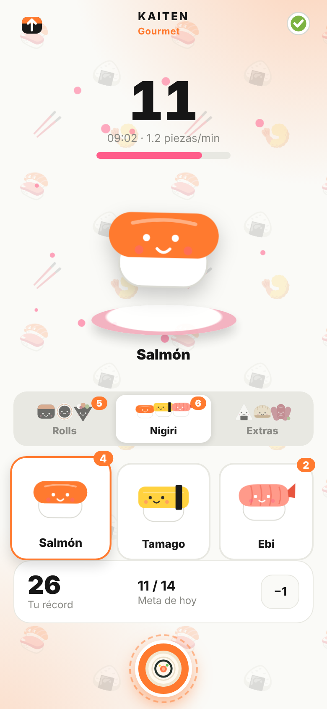 Contador</td>
<td>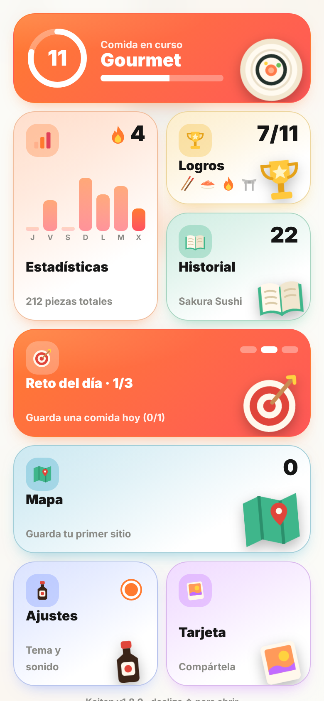 Menú bento</td>
<td>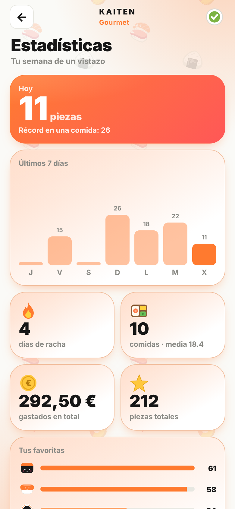 Estadísticas</td>
</tr>
<tr>
<td>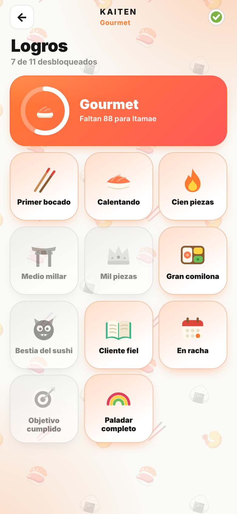 Logros</td>
<td>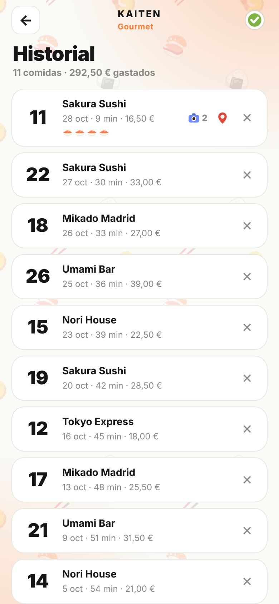 Historial</td>
<td>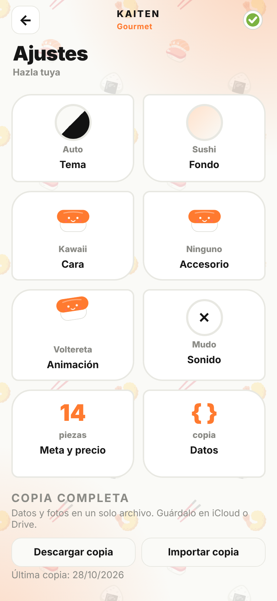 Ajustes</td>
</tr>
<tr>
<td>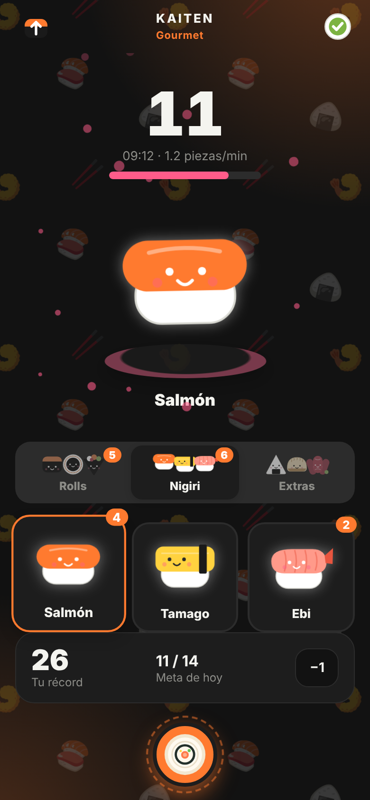 Tema Noche</td>
<td>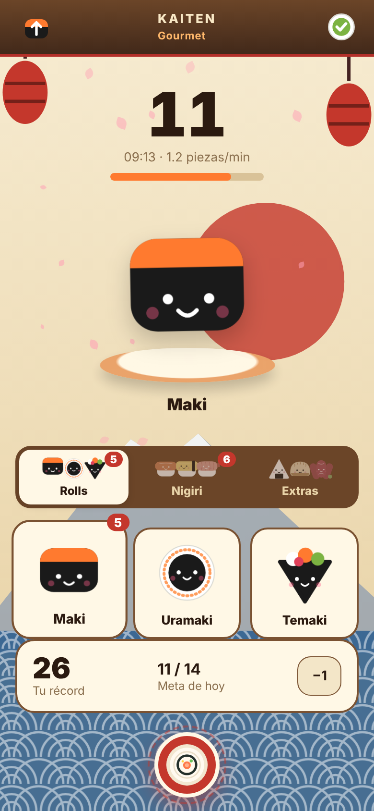 Tema Dojo</td>
<td>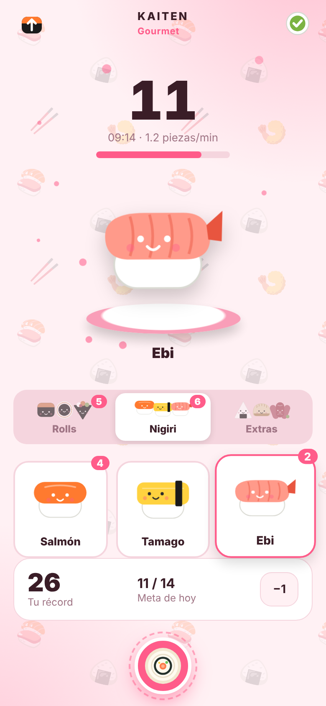 Tema Sakura</td>
</tr>
<tr>
<td>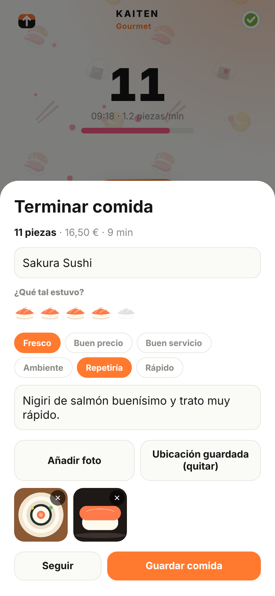 Reseña con fotos</td>
<td>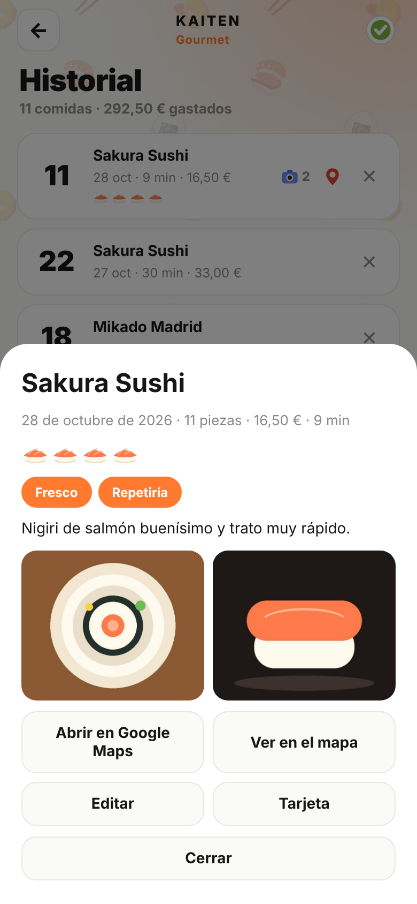 Detalle de comida</td>
<td></td>
</tr>
</table>

### 💻 En el ordenador

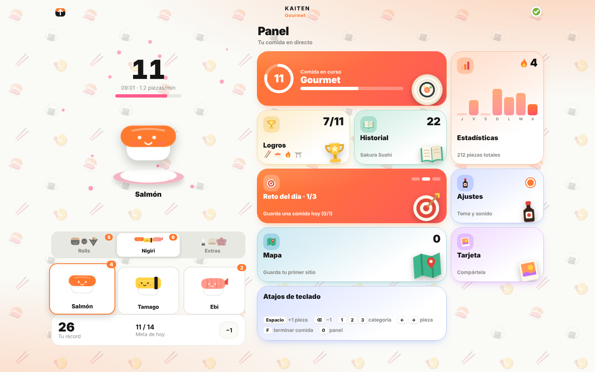 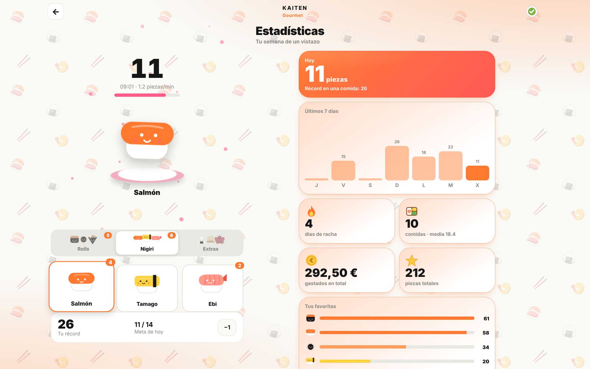

## 🚀 Probarla

- **En línea:** <https://ivanchux.github.io/Kaiten/> (tras activar GitHub Pages, ver [`docs/GITHUB_SETUP.md`](docs/GITHUB_SETUP.md)).
- **En local:** abre `index.html` en el navegador. Para probar el modo PWA necesitas un servidor: `python3 -m http.server 8000` y entra en `http://localhost:8000`.
- **Instalarla como app:**
  - **iPhone (Safari):** botón *Compartir* → *Añadir a pantalla de inicio*. Se abre a pantalla completa y funciona sin conexión.
  - **Android (Chrome):** menú ⋮ → *Instalar aplicación*.
  - Requiere abrirla desde una dirección `https://` (GitHub Pages ya lo es).

## 🗂️ Estructura

| Archivo | Función |
|---|---|
| `index.html` | La app completa (HTML + CSS + JS) |
| `manifest.webmanifest`, `icon*.png`, `icon.svg` | Instalación como app |
| `sw.js` | Caché offline (red primero, caché de respaldo) |
| `docs/` | Capturas, GIF de portada e instrucciones de publicación |
| `.github/` | Workflow de GitHub Pages y plantillas de issues |

### 🗺️ Mapa sin conexión
Por defecto MapLibre se carga desde jsDelivr al abrir el mapa. Para no depender de ningún tercero, descarga `maplibre-gl.js` y `maplibre-gl.css` (versión 4.7.1) a una carpeta `vendor/` y cambia la constante `MU` de `index.html` a `"vendor/maplibre-gl"`. Los mapas en sí siguen necesitando conexión.

## 🔒 Datos

Los datos se guardan en `localStorage` (clave `kaiten.v3`) y las fotos, ya reducidas a ~1000 px, en `IndexedDB`. Nada sale de tu dispositivo salvo al abrir el mapa (se descargan MapLibre desde jsDelivr y los mapas desde OpenFreeMap) o al pulsar un enlace a Google Maps. La ubicación solo se lee cuando pulsas *Usar mi ubicación*. Desde *Ajustes → Datos* puedes copiar o importar tu copia en JSON; el importador valida y limpia los datos antes de aplicarlos.

## 🛠️ Desarrollo

No hay build ni dependencias: edita `index.html` y recarga. Consulta [`CONTRIBUTING.md`](CONTRIBUTING.md).

## 🗺️ Hoja de ruta

- [ ] Torre de platos al estilo kaiten junto al contador
- [ ] Mesa compartida con varios contadores
- [ ] Resumen semanal y mensual compartible
- [ ] Precio por tipo de pieza
- [ ] Reto contrarreloj
- [ ] Traducción al inglés

## 📄 Licencia

Distribuida bajo **[PolyForm Noncommercial 1.0.0](LICENSE)**: puedes usarla, estudiarla, modificarla y compartirla para fines **no comerciales** (uso personal, hobby, educación, organizaciones sin ánimo de lucro).

**No está permitido** venderla, publicarla con anuncios o pagos, ni integrarla en un producto o servicio comercial sin permiso previo y por escrito. Para uso comercial, escríbeme: ivanchu8888@gmail.com.

> Es una licencia *source-available*: el código es visible, pero no es "open source" según la OSI.

## ✍️ Autor

[PolyForm Noncommercial 1.0.0](LICENSE) · Hecho por **[Ivanchux](https://github.com/Ivanchux)** · ivanchu8888@gmail.com
